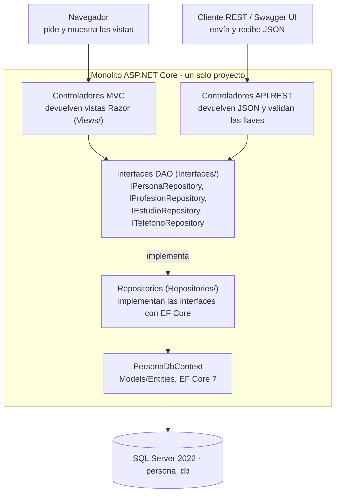
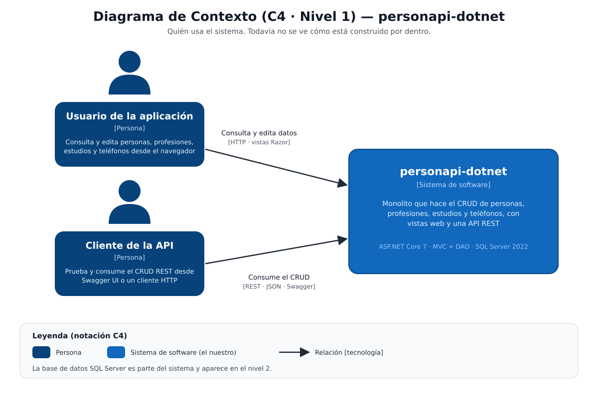
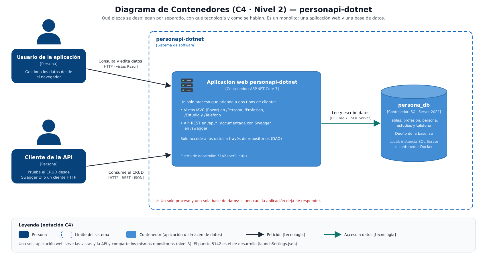
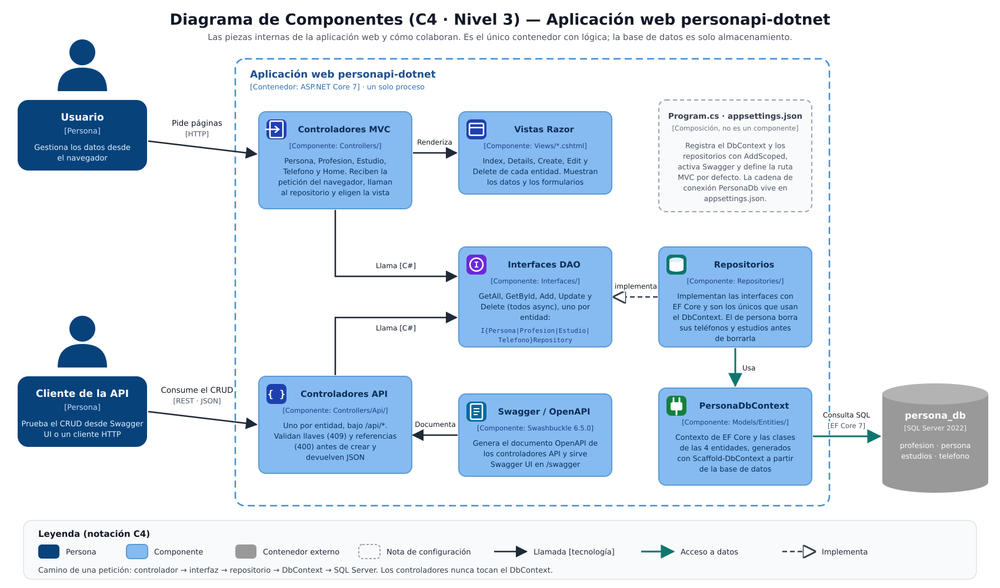
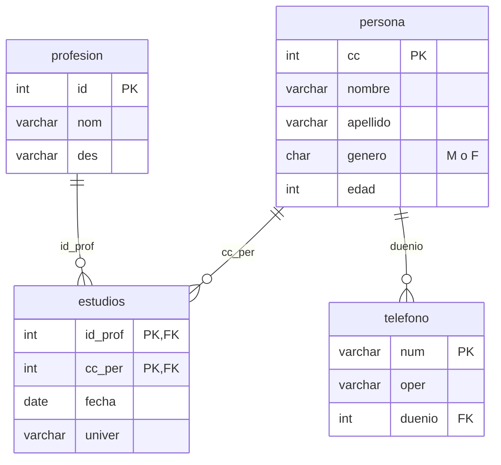

# Laboratorio 1 — personapi-dotnet

## Portada

Monolito en ASP.NET Core con patrón MVC y DAO que implementa el CRUD de personas, profesiones, estudios y teléfonos sobre SQL Server.

| Dato | Valor |
| --- | --- |
| Laboratorio | Laboratorio 1 — Implementación de monolito con patrón MVC y DAO |
| Curso | Arquitectura de Software |
| Universidad | Pontificia Universidad Javeriana |
| Integrantes | [Nombre completo 1], [Nombre completo 2] |
| Profesor | [Nombre del profesor] |
| Fecha | 2026-10-25 |
| Repositorio | https://github.com/AnGISIta12/personapi-dotnet |
| TAG de entrega | [pendiente: se crea al final] |
| Stack | .NET 7, MS SQL Server 2022, REST, Swagger 3 |

## Marco conceptual

El laboratorio combina cinco ideas: un monolito organizado en capas, el patrón MVC para la interfaz, el patrón DAO para el acceso a datos, una API REST documentada con OpenAPI y una base relacional en SQL Server.

### Monolito

Un monolito empaqueta toda la aplicación (vistas, API, lógica y acceso a datos) en un solo proyecto que se compila y se despliega como una unidad. Es simple de construir y de probar, y por eso es un buen punto de partida. Su costo es que cualquier cambio obliga a desplegar todo y que las partes no escalan por separado.

### Patrón MVC (Modelo, Vista, Controlador)

MVC separa la aplicación en tres responsabilidades. El **modelo** representa los datos del dominio. La **vista** los muestra al usuario. El **controlador** recibe la petición, pide o cambia datos y escoge la vista que responde. En ASP.NET Core MVC los controladores heredan de `Controller` y las vistas son archivos Razor (`.cshtml`).

### Patrón DAO y repositorio

DAO (Data Access Object) aisla el acceso a la base de datos detrás de una interfaz. El resto de la aplicación llama a la interfaz y no sabe cómo se guardan los datos. En el proyecto cada entidad tiene una interfaz (`IPersonaRepository`) y una clase que la implementa con Entity Framework Core (`PersonaRepository`). Cambiar la tecnología de persistencia solo toca esas clases.

### Entity Framework Core

EF Core es un ORM: traduce las tablas a clases y las consultas LINQ a SQL. El laboratorio usa el enfoque *database first*: primero se crea la base con scripts y luego `Scaffold-DbContext` genera las entidades y el `DbContext` a partir de ella.

### REST y Swagger

REST expone cada recurso con una URL y usa los verbos HTTP para operarlo: `GET` consulta, `POST` crea, `PUT` actualiza y `DELETE` borra. Las respuestas llevan códigos de estado (200, 201, 204, 400, 404, 409). Swagger/OpenAPI describe esos endpoints en un documento JSON y Swagger UI lo muestra como una página donde se pueden probar.

### SQL Server

SQL Server 2022 es el motor relacional. No tiene `ENUM` ni `INT(n)`, así que el modelo original se adaptó: `genero` es `CHAR(1)` con una restricción `CHECK` y `des` es `VARCHAR(MAX)`.

### Resumen: concepto y dónde está en el proyecto

| Concepto | Dónde se ve |
| --- | --- |
| Monolito | Un solo proyecto, `personapi-dotnet` |
| Controlador (MVC) | `Controllers/*Controller.cs` |
| Vista (MVC) | `Views/<Entidad>/*.cshtml` |
| Modelo | `Models/Entities/` |
| DAO / repositorio | `Interfaces/` y `Repositories/` |
| ORM | `PersonaDbContext` (EF Core 7) |
| API REST | `Controllers/Api/*ApiController.cs` |
| Documentación de la API | Swagger en `/swagger` |

## Diseño

La aplicación es un solo proyecto ASP.NET Core con cuatro capas: controladores, interfaces DAO, repositorios y base de datos. Los controladores nunca tocan el `DbContext`; solo lo usa el repositorio.



Las vistas y la API entran por controladores distintos, pero ambos pasan por las mismas interfaces y repositorios.

### Diagramas C4

El diseño se describe con tres niveles del modelo C4: contexto, contenedores y componentes. El nivel 4 (código) no se dibuja porque los cuatro repositorios tienen la misma forma.

#### Nivel 1 — Contexto



Dos tipos de persona usan el sistema: quien navega las vistas y quien consume la API REST desde Swagger UI o un cliente HTTP. La base de datos es parte del sistema y aparece en el nivel 2.

#### Nivel 2 — Contenedores



El sistema son dos contenedores: una aplicación web ASP.NET Core 7 que sirve las vistas y la API desde un solo proceso, y la base `persona_db` en SQL Server 2022. La aplicación habla con la base por EF Core.

#### Nivel 3 — Componentes



En la aplicación web, los controladores MVC y API llaman a las interfaces DAO. Los repositorios las implementan y son los únicos que usan el `PersonaDbContext`. Swagger documenta los controladores API y `Program.cs` conecta las piezas.

### Modelo de datos

El modelo tiene cuatro tablas. `estudios` es la tabla intermedia entre `persona` y `profesion`, con llave primaria compuesta. Una persona tiene muchos teléfonos.

| Tabla | Campos | Llaves |
| --- | --- | --- |
| profesion | id INT, nom VARCHAR(90), des VARCHAR(MAX) | PK id |
| persona | cc INT, nombre VARCHAR(45), apellido VARCHAR(45), genero CHAR(1) con CHECK M/F, edad INT | PK cc |
| estudios | id_prof INT, cc_per INT, fecha DATE, univer VARCHAR(50) | PK (id_prof, cc_per); FK a profesion y a persona |
| telefono | num VARCHAR(15), oper VARCHAR(45), duenio INT | PK num; FK duenio a persona |



`estudios` resuelve la relación muchos a muchos entre persona y profesión; `telefono` depende de una sola persona.

### Capas

| Capa | Carpeta | Responsabilidad |
| --- | --- | --- |
| Controlador MVC | `Controllers/*Controller.cs` | Recibe la petición del navegador, llama al repositorio y devuelve una vista |
| Controlador API | `Controllers/Api/` | Expone el CRUD como REST y valida llaves y referencias |
| Vista | `Views/<Entidad>/` | Index, Details, Create, Edit y Delete de cada entidad |
| Interfaz DAO | `Interfaces/` | Contrato de acceso a datos de cada entidad |
| Repositorio | `Repositories/` | Implementa la interfaz con EF Core; es el único que usa el `DbContext` |
| Entidades y contexto | `Models/Entities/` | Clases generadas con `Scaffold-DbContext` y `PersonaDbContext` |
| Configuración | `Program.cs`, `appsettings.json` | Registra el contexto, los repositorios y Swagger; guarda la cadena de conexión |

### Endpoints REST

| Recurso | Listar | Obtener, actualizar y eliminar | Crear |
| --- | --- | --- | --- |
| Persona | `GET /api/personas` | `GET, PUT, DELETE /api/personas/{cc}` | `POST /api/personas` |
| Profesión | `GET /api/profesiones` | `GET, PUT, DELETE /api/profesiones/{id}` | `POST /api/profesiones` |
| Teléfono | `GET /api/telefonos` | `GET, PUT, DELETE /api/telefonos/{num}` | `POST /api/telefonos` |
| Estudio | `GET /api/estudios` | `GET, PUT, DELETE /api/estudios/{idProf}/{ccPer}` | `POST /api/estudios` |

Respuestas: 200 al consultar, 201 al crear, 204 al actualizar o borrar, 404 si no existe, 409 si la llave ya existe y 400 si la persona o la profesión referenciada no existe o la llave de la URL no coincide con la del cuerpo.

### Decisiones de diseño

- **Dos controladores por entidad.** Uno MVC con vistas y otro API con JSON, que comparten la misma interfaz de repositorio. La lógica de datos no se repite.
- **Repositorios con vida *scoped*.** Se registran con `AddScoped` en `Program.cs`: una instancia por petición, igual que el `DbContext`.
- **Borrado en cascada desde el repositorio.** Las llaves foráneas del script no tienen `ON DELETE CASCADE`. Por eso `PersonaRepository.DeleteAsync` borra primero los teléfonos y estudios de la persona.
- **Validación en el controlador API.** Antes de crear revisa que la llave no exista (409) y que las referencias sí (400), para devolver un mensaje claro en vez de un error de la base.
- **Propiedades de navegación marcadas.** `[JsonIgnore]` evita ciclos al serializar y `[ValidateNever]` evita que los formularios las pidan.
- **Llaves no editables.** `cc`, `id`, `num` y `id_prof + cc_per` no se cambian; para corregirlas se borra el registro y se crea de nuevo.
- **Cadena de conexión fuera del código.** Está en `appsettings.json` y se puede reemplazar con la variable `ConnectionStrings__PersonaDb`.

## Procedimiento

El laboratorio se desarrolló en diez pasos, de la base de datos al TAG. Se usaron las versiones del stack (.NET 7 y SQL Server 2022); el enunciado menciona .NET 6.0 y SQL Server 2019 Express en el procedimiento.

### 1. Repositorio

Se creó el repositorio público `personapi-dotnet` en GitHub y se clonó en local: https://github.com/AnGISIta12/personapi-dotnet.

### 2. Base de datos

Se instaló SQL Server (2022, o 2019 Express en modo Básico) y SQL Server Management Studio. En SSMS se ejecutaron, en este orden, los scripts de la carpeta `database/`:

1. `ddl.sql`: crea `persona_db`, le da la propiedad al usuario `sa` y crea las cuatro tablas con sus llaves.
2. `dml.sql`: carga 4 profesiones, 4 personas, 5 estudios y 5 teléfonos de prueba.

Alternativa sin instalar SQL Server: con Docker, `docker compose up -d` levanta SQL Server 2022 en `localhost:1433` y corre los dos scripts solo la primera vez.

```bash
docker compose up -d
```

### 3. Proyecto

En Visual Studio Community 2022, con las cargas de trabajo Desarrollo de ASP.NET y web, Almacenamiento y procesamiento de datos, Plantillas de proyecto y elementos de .NET Framework y Características avanzadas de ASP.NET, se creó un proyecto con la plantilla **Aplicación web de ASP.NET Core (Modelo-Vista-Controlador)**: nombre `personapi-dotnet`, .NET 7, sin autenticación y sin configuración HTTPS.

### 4. Paquetes NuGet

| Paquete | Versión | Uso |
| --- | --- | --- |
| Microsoft.EntityFrameworkCore | 7.0.20 | ORM |
| Microsoft.EntityFrameworkCore.SqlServer | 7.0.20 | Proveedor de SQL Server |
| Microsoft.EntityFrameworkCore.Tools | 7.0.20 | Comando `Scaffold-DbContext` |
| Swashbuckle.AspNetCore | 6.5.0 | Swagger / OpenAPI |

### 5. Entidades y contexto

En la carpeta `Models` se creó la subcarpeta `Entities` y, en la Consola del Administrador de paquetes, se generó el modelo desde la base:

```powershell
Scaffold-DbContext "Server=localhost\SQLEXPRESS;Database=persona_db;Trusted_Connection=True;TrustServerCertificate=true" Microsoft.EntityFrameworkCore.SqlServer -OutputDir Models/Entities
```

Después de generarlo se hicieron tres ajustes: se quitó `OnConfiguring` del contexto, la cadena de conexión pasó a `appsettings.json` y las propiedades de navegación recibieron `[JsonIgnore]` y `[ValidateNever]`.

### 6. Interfaces y repositorios

Se crearon cuatro interfaces en `Interfaces/` y sus cuatro implementaciones en `Repositories/`, con las operaciones `GetAllAsync`, `GetByIdAsync`, `AddAsync`, `UpdateAsync` y `DeleteAsync`. En `Program.cs` se registraron el contexto y los repositorios:

```csharp
builder.Services.AddDbContext<PersonaDbContext>(options =>
    options.UseSqlServer(builder.Configuration.GetConnectionString("PersonaDb")));
builder.Services.AddScoped<IPersonaRepository, PersonaRepository>();
```

### 7. Controladores y vistas

Por cada entidad se crearon un controlador MVC con sus cinco vistas (Index, Details, Create, Edit, Delete) y un controlador API en `Controllers/Api/`. Swagger se activó en `Program.cs` con `AddSwaggerGen`, `UseSwagger` y `UseSwaggerUI`.

### 8. Compilación y ejecución

```bash
dotnet restore
dotnet build
cd personapi-dotnet
dotnet run
```

La aplicación queda en `http://localhost:5142`. Las vistas están en `/Persona`, `/Profesion`, `/Estudio` y `/Telefono`, y Swagger en `/swagger`.

### 9. Despliegue

```bash
dotnet publish personapi-dotnet/personapi-dotnet.csproj -c Release -o ./publish
cd publish
dotnet personapi-dotnet.dll --urls http://localhost:5000
```

La carpeta `publish` también puede montarse en IIS con el Hosting Bundle de .NET 7.

### 10. Push y TAG

```bash
git push origin main
git tag -a v1.0 -m "Laboratorio 1"
git push origin v1.0
```

### Pruebas realizadas

El 2026-10-25 se probó el código del repositorio contra SQL Server 2022 en Docker, con el SDK de .NET 7 en un contenedor. Todo respondió como se esperaba.

| Prueba | Resultado |
| --- | --- |
| `ddl.sql` y `dml.sql` sobre SQL Server 2022 | Sin errores; 4 profesiones, 4 personas, 5 estudios, 5 teléfonos; `sa` es dueño de la base |
| Segunda ejecución de `docker compose up` | Detecta que `persona_db` existe y no la toca |
| Compilación y arranque con .NET 7 | Correcto |
| Vistas `/`, `/Persona`, `/Profesion`, `/Estudio`, `/Telefono` y `swagger.json` | 200 |
| `GET` de las cuatro listas de la API | 200 con los datos cargados |
| `POST` de persona, teléfono y estudio nuevos | 201 |
| `POST` de una persona con llave repetida | 409 |
| `POST` de un teléfono con dueño inexistente | 400 |
| `PUT` de una persona | 204 |
| `DELETE` de una persona con teléfonos y estudios | 204; luego `GET` de la persona y su teléfono da 404 |

No se probó todavía la ruta con SQL Server Express y autenticación de Windows (`localhost\SQLEXPRESS`), que es la cadena que trae `appsettings.json`.

### Capturas por insertar

- [ ] SSMS con `persona_db` y sus cuatro tablas
- [ ] Resultado de `dml.sql` (consulta a cada tabla)
- [ ] Creación del proyecto en Visual Studio
- [ ] Salida de `Scaffold-DbContext`
- [ ] Vistas CRUD de Persona, Profesión, Estudio y Teléfono
- [ ] Página de Swagger con los cuatro recursos
- [ ] Una petición de Swagger con su respuesta
- [ ] Repositorio en GitHub con el TAG

## Conclusiones y lecciones aprendidas

La aplicación cumple el alcance del laboratorio: CRUD de las cuatro entidades por vistas MVC y por API REST, con acceso a datos aislado en repositorios. Las capas dejaron claro dónde va cada responsabilidad y permitieron que la API y las vistas reutilicen los mismos repositorios.

### Conclusiones

- Separar interfaz y repositorio hace que los controladores no dependan de EF Core ni de SQL Server.
- Un monolito de un solo proyecto fue suficiente para este tamaño y se compila y se ejecuta con tres comandos.
- Swagger documenta y permite probar la API sin escribir un cliente.
- La aplicación no tiene autenticación ni pruebas automatizadas, y Swagger queda activo en todos los ambientes. Son límites aceptables para un laboratorio, no para producción.

### Lecciones aprendidas

- **Los scripts no crean la base por sí solos.** Un compañero de equipo descubrió que la base no existía en su equipo porque los scripts de `database/` solo se ejecutan donde alguien los corre. Un `docker-compose.yml` que carga los scripts hace el ambiente reproducible con un comando.
- **Hay que adaptar el modelo al motor.** SQL Server no tiene `ENUM` ni `INT(n)`; `genero` pasó a `CHAR(1)` con `CHECK` y `des` a `VARCHAR(MAX)`.
- **Las llaves foráneas sin `ON DELETE CASCADE` obligan a decidir quién borra.** Aquí lo hace el repositorio de persona. Declarar la cascada en el script sería más simple y evitaría que otro código se salte esa regla.
- **Lo que genera `Scaffold-DbContext` necesita ajustes.** Las propiedades de navegación causan ciclos al serializar a JSON y los formularios las exigen; hubo que marcarlas con `[JsonIgnore]` y `[ValidateNever]`.
- **Las versiones del enunciado no siempre coinciden.** El procedimiento habla de .NET 6.0 y SQL Server 2019 y el stack, de .NET 7 y SQL Server 2022. Se siguió el stack y se dejó escrito.
- **Probar contra una base real da evidencia, no solo lectura del código.** Las pruebas de los códigos 201, 400, 404, 409 y de la cascada confirmaron que el comportamiento coincide con lo documentado.

## Referencias

Páginas consultadas el 2026-10-25.

1. Microsoft. [Overview of ASP.NET Core MVC](https://learn.microsoft.com/en-us/aspnet/core/mvc/overview?view=aspnetcore-7.0).
2. Microsoft. [Scaffolding (Reverse Engineering) — EF Core](https://learn.microsoft.com/en-us/ef/core/managing-schemas/scaffolding/).
3. Microsoft. [Get started with Swashbuckle and ASP.NET Core](https://learn.microsoft.com/en-us/aspnet/core/tutorials/getting-started-with-swashbuckle?view=aspnetcore-7.0).
4. Microsoft. [Dependency injection in ASP.NET Core](https://learn.microsoft.com/en-us/aspnet/core/fundamentals/dependency-injection?view=aspnetcore-7.0).
5. Microsoft. [Quickstart: Run SQL Server Linux container images with Docker](https://learn.microsoft.com/en-us/sql/linux/quickstart-install-connect-docker?view=sql-server-ver16).
6. Fowler, M. [Repository](https://martinfowler.com/eaaCatalog/repository.html), *Patterns of Enterprise Application Architecture*.
7. Fowler, M. [MonolithFirst](https://martinfowler.com/bliki/MonolithFirst.html).
8. OpenAPI Initiative. [OpenAPI Specification v3.0.3](https://spec.openapis.org/oas/v3.0.3).
9. Repositorio del laboratorio: [AnGISIta12/personapi-dotnet](https://github.com/AnGISIta12/personapi-dotnet).
